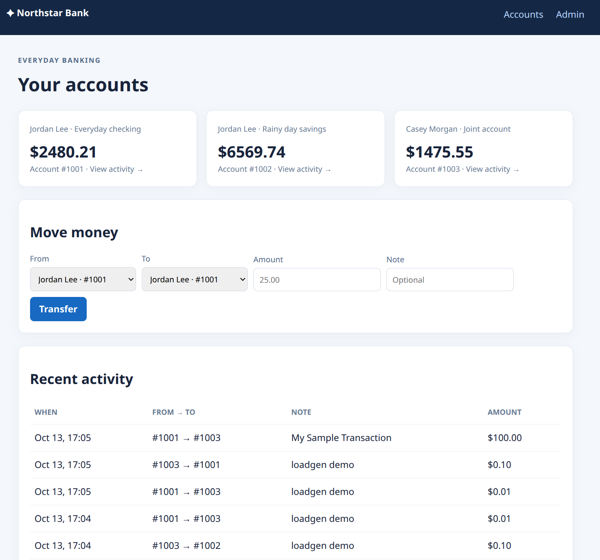
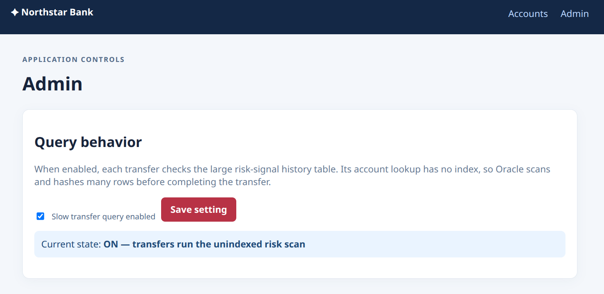
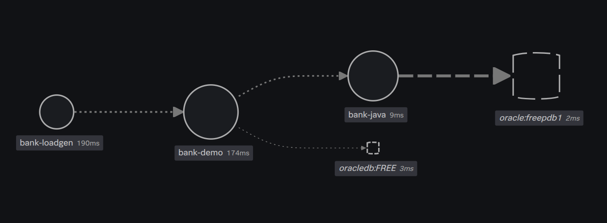
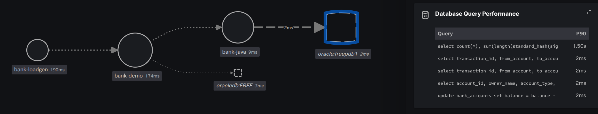
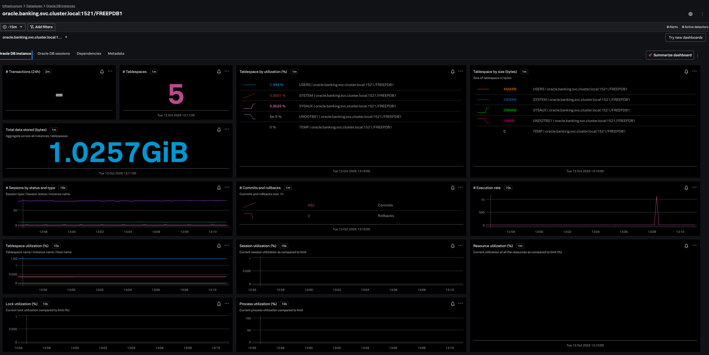

# Oracle banking services with zero-code OpenTelemetry on k3d

This example runs a Python banking UI and request router, a Java banking service, a continuous load generator, Oracle Free, and the Splunk OpenTelemetry Collector. Each Python page read or transfer randomly uses either Python's direct Oracle connection or the Java service, which then queries Oracle. The Collector and OpenTelemetry Operator are installed before the application pods, so the Operator injects zero-code instrumentation as those pods are created.

> This app uses demo accounts and local demo credentials. It is for local learning only, not real banking or internet exposure.

## Requirements

- Docker
- k3d
- kubectl
- Helm
- A Splunk Observability Cloud realm and access token with ingest permissions
- About 5 GB free disk space for Oracle and its data volume, plus several GB for language images

## Demo

This demo shows an application in python and a service in java. Both services, for the purposes of the demonstration, connect to the database.

The application:


You can toggle slow queries:


In Splunk Observability, the Service Map:


When you toggle slow queries you can see slow queries and investigate them:


Oracle DB metrics are also collected:



## Optional: copy the example to another host

You can run the cluster on a Multipass VM or another SSH-accessible Linux host. Copy the whole `k8s-oracle` directory, then run the remaining commands in this README from that host.

For Multipass, replace `INSTANCE` with the VM name:

```sh
multipass transfer --recursive instrumentation/oracle/k8s-oracle INSTANCE:.
multipass shell INSTANCE
cd ~/k8s-oracle
```

For another SSH host, replace `USER@HOST` with its SSH destination:

```sh
rsync -av instrumentation/oracle/k8s-oracle/ USER@HOST:~/k8s-oracle/
ssh USER@HOST
cd ~/k8s-oracle
```

## 1. Create the k3d cluster and start Oracle

Oracle starts first because the Collector's Oracle receiver needs a reachable database and a monitoring user. The Oracle init scripts create the banking schema, seed the synthetic transfer history, and create the limited `otel_monitor` user.

```sh
k3d cluster create bank-demo --agents 1 -p "8080:30080@loadbalancer"
kubectl create namespace banking
kubectl create configmap oracle-init -n banking \
  --from-file=oracle-init.sql=k8s/oracle-init.sql \
  --from-file=oracle-monitor-user.sql=k8s/oracle-monitor-user.sql \
  --dry-run=client -o yaml | kubectl apply -f -
kubectl apply -n banking -f k8s/oracle.yaml
kubectl rollout status -n banking statefulset/oracle --timeout=10m
```

The first Oracle startup takes several minutes while it creates the database and seeds the 750,000-row transfer history.

The monitor user has read access to Oracle performance views required by the receiver. Its demo password is `monitorpass`; change it in `k8s/oracle-monitor-user.sql` and the Kubernetes Secret command below if you reuse this example.

## 2. Install Splunk OpenTelemetry before the app workloads

First set your realm (for example, `us1`) and the access token.

```sh
export SPLUNK_REALM=us1
export SPLUNK_ACCESS_TOKEN=<token>
```

Then create Kubernetes Secrets for Collector authentication and the Oracle monitoring account. (NOTE: This will unset the access token for security):

```sh
kubectl create namespace observability --dry-run=client -o yaml | kubectl apply -f -
kubectl create secret generic splunk-otel-secret -n observability \
  --from-literal=splunk_observability_access_token="$SPLUNK_ACCESS_TOKEN" \
  --from-literal=splunk_realm="$SPLUNK_REALM" \
  --dry-run=client -o yaml | kubectl apply -f -
unset SPLUNK_ACCESS_TOKEN

kubectl create secret generic oracle-monitoring -n observability \
  --from-literal=oracle_monitor_password=monitorpass \
  --dry-run=client -o yaml | kubectl apply -f -
```

Add the Splunk Helm repository and install the Collector, database receiver, and OpenTelemetry Operator. The access token stays in the Kubernetes Secret; `provided-by-secret` is only a non-secret placeholder used to enable the chart destination.

```sh
helm repo add splunk-otel-collector-chart https://signalfx.github.io/splunk-otel-collector-chart
helm repo update
helm upgrade --install splunk-otel-collector \
  splunk-otel-collector-chart/splunk-otel-collector \
  --namespace observability --create-namespace \
  --set splunkObservability.realm="$SPLUNK_REALM" \
  --set splunkObservability.accessToken=provided-by-secret \
  --set secret.create=false \
  --set secret.name=splunk-otel-secret \
  --set operatorcrds.install=true \
  --set operator.enabled=true \
  --set instrumentation.installationJob.enabled=true \
  -f k8s/otel-values.yaml
```

`k8s/otel-values.yaml` configures Oracle query and metric collection on the single-replica cluster receiver, avoiding duplicate Oracle polling from each node agent. It enables `db.server.query_sample` and `db.server.top_query` events and exports database monitoring events through the Splunk Database Monitoring endpoint. Oracle query correlation requires a Collector version 0.156.0 or later. Leave the Oracle receiver's query-sampling intervals at their defaults; see the [Oracle receiver documentation](https://help.splunk.com/en/splunk-observability-cloud/manage-data/splunk-distribution-of-the-opentelemetry-collector/get-started-with-the-splunk-distribution-of-the-opentelemetry-collector/collector-components/receivers/oracle-database-receiver) for the current grants and compatibility matrix.

Wait until the Collector and Operator are ready and the default Instrumentation resource exists:

```sh
kubectl get pods -n observability
kubectl get otelinst -n observability
```

The pod annotations in `k8s/app.yaml` refer to `observability/splunk-otel-collector`. The default chart release creates that Instrumentation resource and supports Python and Java injection. The Python image includes `opentelemetry-instrumentation-oracledb`, which registers the Oracle driver instrumentor with the injected Python agent. Splunk's Java JDBC instrumentation needs `OTEL_INSTRUMENTATION_SPLUNK_JDBC_ENABLED=true`; that variable is set on the Java deployment.

## 3. Build and start the Python and Java services

Build both images and import them into k3d:

```sh
docker build -t bank-demo:local .
docker build -t bank-java:local -f java/Dockerfile java
k3d image import bank-demo:local -c bank-demo
k3d image import bank-java:local -c bank-demo
```

Only after the Collector and Operator are ready, create the app pods. This lets the admission webhook inject instrumentation on their first creation, with no follow-up rollout:

```sh
kubectl apply -n banking -f k8s/app.yaml
kubectl rollout status -n banking deployment/bank-demo
kubectl rollout status -n banking deployment/bank-loadgen
kubectl rollout status -n banking deployment/bank-java
```

The Python service provides the browser UI at <http://localhost:8080>; the admin page is <http://localhost:8080/admin>. Each page read and transfer independently chooses Python-direct or Java-backed database access. The response includes `X-DB-Backend: python` or `X-DB-Backend: java`; the load generator prints the selected backend for each read and transfer. It calls only the Python service, which routes a selected request to Java when appropriate.

On Python-direct requests, the OracleDB instrumentation emits database client spans under the Python trace. The instrumentor is currently published as a beta package. These spans make Python's database calls visible in APM; Splunk's Oracle Database Monitoring query-to-trace correlation compatibility matrix currently documents Java JDBC for Oracle, so the Python spans do not provide the same Database Monitoring links as the Java path.

Enable **Slow transfer query** in the Python admin page to make transfers on either path scan and hash the unindexed 750,000-row `bank_transfer_signals` table. Python forwards the setting to Java when a transfer takes that path. The always-running load generator reads the UI every few seconds and submits transfers about every ten seconds.

The Java service is cluster-internal. To call it directly from your workstation, run:

```sh
kubectl port-forward -n banking service/bank-java 8081:8081
```

Then query its account API:

```sh
curl http://localhost:8081/accounts
```

The Java service also has `/health` and `/activity`, and accepts JSON transfers at `POST /transfer`, for example:

```sh
curl -X POST http://localhost:8081/transfer \
  -H 'Content-Type: application/json' \
  -d '{"source":1001,"destination":1002,"amount":0.25,"memo":"demo","slow":false}'
```

To exercise the Java slow-query path and generate a longer JDBC span, use `"slow":true`; it scans and hashes the same unindexed transfer history table as the Python example.

## Oracle query correlation notes

Oracle Database Monitoring collects query samples independently from application spans. Splunk correlates supported Java JDBC spans with Oracle query samples when the Java agent propagates the trace context into Oracle session metadata. Only sampled query statements have correlation data, so traces do not all show database query links.

Splunk's current compatibility matrix documents Oracle query correlation for Java JDBC with Splunk Java agent 2.20.1+ and Splunk Collector 0.156.0+; it does not list Python with Oracle. Requests routed through Java can therefore show Oracle query-to-trace correlation, while direct Python-to-Oracle requests still receive zero-code application tracing without that database correlation. Splunk's Oracle Database Monitoring support matrix lists Oracle 26ai, 21c, 19c, 18c, and 12c; check the database version before relying on query samples from an older persisted volume. See [Splunk's database correlation guide](https://help.splunk.com/en/splunk-observability-cloud/monitor-databases/correlate-database-queries-with-splunk-apm-traces) and [Java correlation configuration](https://help.splunk.com/en/splunk-observability-cloud/monitor-databases/correlate-database-queries-with-splunk-apm-traces/correlate-database-queries-with-java-traces).

In Splunk Observability Cloud, use APM to inspect `bank-demo` and `bank-java`. Database Monitoring requires the appropriate Splunk license; once Oracle query samples arrive, its query details can link to correlated Java traces.

## Useful commands

```sh
kubectl get pods -n banking
kubectl logs -n banking statefulset/oracle
kubectl logs -n banking deployment/bank-demo
kubectl logs -n banking deployment/bank-loadgen -f
kubectl logs -n banking deployment/bank-java
kubectl logs -n observability daemonset/splunk-otel-collector-agent
```

The Oracle StatefulSet uses a persistent volume claim. Deleting namespace `banking` removes its database data. Deleting namespace `observability` removes the Collector, Operator, and their Secrets. These manifests use local demo credentials and are not intended for internet exposure.
